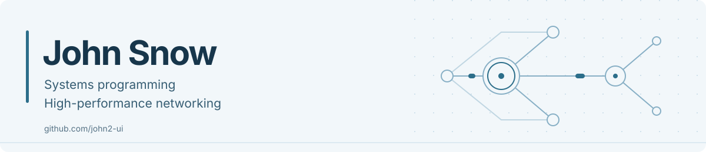
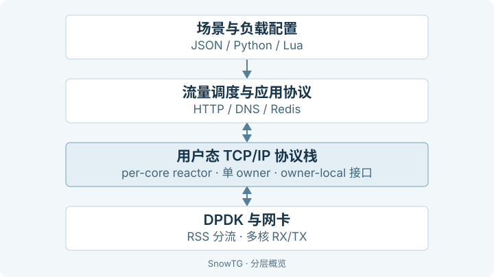

**kenianchen · John Snow** &nbsp; / &nbsp; 中山大学 · 软件工程本科在读

专注 **C/C++、高性能网络与异步 I/O**，通过项目探索协议栈、并发与底层系统设计。

[技术栈](#技术栈) · [实习经历](#实习经历) · [教育背景](#教育背景) · [精选项目](#精选项目)

## 技术栈

**系统编程** &nbsp; `C` `C++17 / C++20` `Linux` `内存管理` `并发编程`

**高性能网络** &nbsp; `DPDK` `TCP/IP` `UDP` `用户态协议栈` `RSS`

**异步 I/O** &nbsp; `C++20 协程` `io_uring` `epoll` `kqueue` `IOCP`

**工程与调优** &nbsp; `CMake` `CI` `ASan / UBSan` `perf` `tcpdump / Wireshark`

正在探索 **Rust / Tokio、eBPF / XDP**，相关实践见 [udp-lb](https://github.com/john2-ui/udp-lb) 和 [RouteScope](https://github.com/john2-ui/routescope)。

## 实习经历

### 腾讯云 · 高性能网络中心 · 自研 DPU 团队

**实习生** &nbsp; · &nbsp; 2026.10 - 至今

### 上海辛米尔视觉科技公司

**软件开发实习生** &nbsp; · &nbsp; 2026.07 - 2026.10

- 独立实现相机 Modbus 通信模块及业务接口，完成模拟测试、通信联调和相机实机验证。
- 抽象目标跟踪算法统一接口，隔离平台差异，降低业务与算法实现的耦合。

## 教育背景

**中山大学** &nbsp; · &nbsp; 软件工程本科 &nbsp; · &nbsp; 2024 - 至今

**广州执信中学** &nbsp; · &nbsp; 高中

## 精选项目

### [SnowTG](https://github.com/john2-ui/SnowTG)

基于 DPDK 的可扩展混合流量发生器。实现用户态 TCP/IP 协议栈，支持多核流量分发、混合协议流量与业务剧本扩展。

`C` `DPDK` `TCP/IP` `RSS` `Python / Lua`



单个连接由固定 owner 驱动，流量调度与应用协议通过 owner-local 接口使用协议栈。

[架构详解](https://github.com/john2-ui/SnowTG/blob/master/docs/TODO.md#项目架构) · [性能数据与复现条件](https://github.com/john2-ui/SnowTG/blob/master/docs/BENCHMARK.md)

### [snowy](https://github.com/john2-ui/snowy)

跨平台 C++20 协程与异步 I/O 库。统一 TCP/UDP、定时器和文件 I/O，提供任务组合、安全取消及 Channel/Mailbox，覆盖 Linux、macOS 与 Windows。

`C++20` `io_uring` `kqueue` `IOCP` `结构化并发`

一个定时器协程：等待时挂起任务，不阻塞事件循环线程。

```cpp
#include <snowy/snowy.hpp>
#include <iostream>

snowy::task<> hello(snowy::loop& loop) {
    co_await loop.sleep(std::chrono::milliseconds{10});
    std::cout << "Hello\n";
}

int main() {
    snowy::loop loop;
    loop.run(hello(loop));
}
```

[构建与依赖](https://github.com/john2-ui/snowy#build) · [完整定时器示例](https://github.com/john2-ui/snowy/blob/main/examples/timer.cpp) · [TCP Echo 示例](https://github.com/john2-ui/snowy/blob/main/examples/echo.cpp)

<details>
<summary>更多系统与网络实践</summary>

- [udp-lb](https://github.com/john2-ui/udp-lb)：使用 Rust 与 eBPF/XDP 实现 UDP 负载均衡。
- [RouteScope](https://github.com/john2-ui/routescope)：基于 TC eBPF 的网络流量观测与可视化。
- [lfq_bench](https://github.com/john2-ui/lfq_bench)：并发队列实现与性能对比。
- [SnowSeek](https://github.com/john2-ui/SnowSeek)：C++20 全文检索项目，包含倒排索引与 BM25 排序。

</details>

---

欢迎在相关 [GitHub 项目](https://github.com/john2-ui?tab=repositories) 的 Issues 中交流系统与网络技术。
